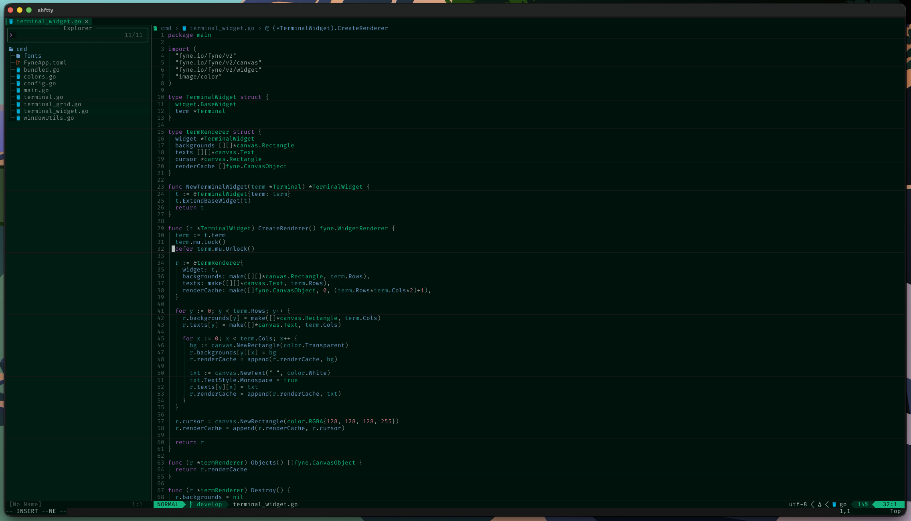

shftty is a shitty fucking terminal emulator written in Go

## What Works
- 256 color support (kinda)
- Essential VT100 escape sequences (kinda)
- Custom fonts (kinda)
- NeoVim (kinda)

## What doesn't work
- 256 color support
- Essential VT100 escape sequences
- NeoVim
- Mouse support
- Kitty Graphics Protocol
- Python REPL
- Claude/AGY (probably, not tested but they use React to render their TUI and I can't imagine that shit works here)
- Everything else...

### TODO 
- Implement the rest of the ANSI escape codes
- Fix everything else
