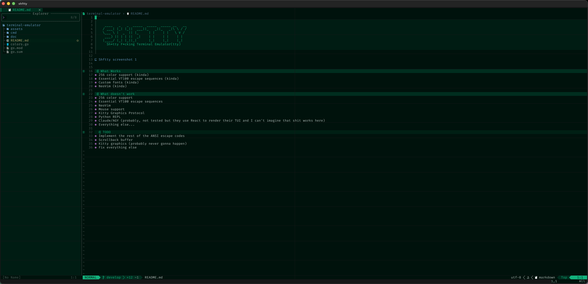

```

     ____   _   _  _____  _____  _____ __   __
    / ___| |_| |_||  ___||_   _||_   _|\ \ / /
    \___ \ |  _  || |_     | |    | |   \ V / 
     ___) || | | ||  _|    | |    | |    | |  
    |____/ |_| |_||_|      |_|    |_|    |_|  
      Sh*tty F*cking Terminal Emulator(tty)                                         

```                                          




## What Works
- 256 color support (kinda)
- Essential VT100 escape sequences (kinda)
- Custom fonts (kinda)
- NeoVim (kinda)

## What doesn't work
- 256 color support
- Essential VT100 escape sequences
- NeoVim
- Mouse support
- Kitty Graphics Protocol
- Python REPL
- Claude/AGY (probably, not tested but they use React to render their TUI and I can't imagine that shit works here)
- Everything else...

### TODO 
- Implement the rest of the ANSI escape codes
- Scrollback buffer
- Kitty graphics (probably never gonna happen)
- Fix everything else
